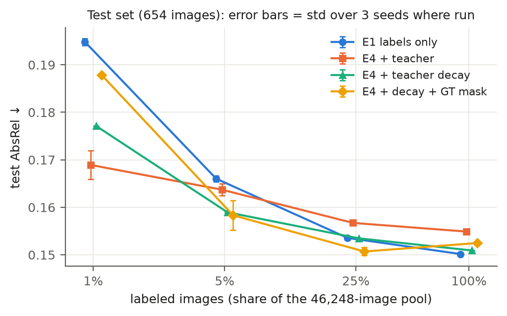
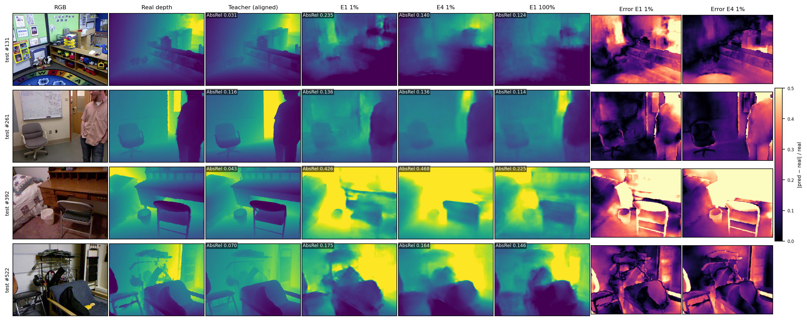
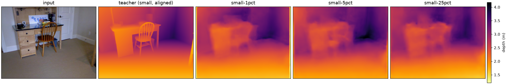

# Small and Fast Depth Estimation with Few Labels

[](https://github.com/oguz-kagan-gocmez-edu/knowledge-distillation-depth/actions/workflows/ci.yml)

CS466 Deep Learning (Fall 2026) term project, Özyeğin University. Author: Oğuz Kağan Göçmez.

A small student network (1–4M parameters) learns monocular depth on NYU Depth V2 from a
few labeled images plus a large teacher (Depth Anything V2, 24.8M) on the unlabeled images.
The goal is a model about 8× smaller than the teacher that runs in real time, and a study of
**when the teacher helps and when it does not**.

## Current status

Training and the test set are done; the report is next. Validation AbsRel of the 3.15M student
(lower is better, the teacher gets 0.110):

| Labeled images | Labels only (E1) | + teacher on unlabeled images (E4) | Change | E4 + teacher decay | Change | + GT mask | Change |
|---|---|---|---|---|---|---|---|
| 1% (462) | 0.199 | 0.176 | −11% | **0.175** | **−12%** | 0.189 | −5% |
| 5% (2,312) | 0.166 | 0.170 | +2.5% | 0.163 | −2% | **0.159** | **−4%** |
| 25% (11,562) | 0.156 | 0.168 | +8% | 0.159 | +2% | **0.154** | **−1%** |
| 100% (46,248) | **0.153** | 0.164 | +7% | 0.157 | +3% | 0.157 | +3% |

- With very few labels the teacher helps, on every labeled subset and student size tried.
- The gain comes from the teacher's targets on the unlabeled images; the edge loss adds nothing measurable.
- With more labels the teacher holds the student back.
- Fading the teacher out over the second half of training (teacher decay) keeps the gain with few
  labels and removes most of the harm with many.
- Keeping the teacher off the labeled images (GT mask) gives the best 5% and 25% results, but at 1%
  the teacher on the labeled images is what stops the student from memorizing them.

**Test set** (654 NYU images, evaluated once at the end; 3 seeds where ± is shown):

| Labeled images | Labels only (E1) | E4 | E4 + decay | E4 + decay + GT mask | Best vs E1 |
|---|---|---|---|---|---|
| 1% (462) | 0.195 ± 0.001 | **0.169 ± 0.003** | 0.177 | 0.188 | **−13%** |
| 5% (2,312) | 0.166 ± 0.001 | 0.164 ± 0.001 | 0.159 | **0.158 ± 0.003** | **−5%** |
| 25% (11,562) | 0.154 ± 0.000 | 0.157 | 0.153 | **0.151 ± 0.001** | −2% |
| 100% (46,248) | **0.150** | 0.155 | 0.151 | 0.152 | – |

With all labels the small student reaches AbsRel 0.150, RMSE 0.526 and δ1 0.794, in the range of
published full-size models from 2015–2016 (see the comparison in the results file; the teacher,
aligned per image to the real depth, gets 0.062). It has 8×
fewer parameters and 144× fewer FLOPs than the teacher and runs in 8.5 ms on an M4 Pro GPU
(teacher: 45 ms). With 1% labels the teacher mostly improves the shape of the depth map: after
per-image scaling the error falls by 19%, so the metric scale still has to come from the labels.



Four evenly spaced test images, with the real depth, the teacher, the student with labels only (E1)
and with the teacher (E4) at 1% labels, and E1 with all labels; the last two columns show the
relative error of E1 and E4 at 1% (made by `scripts/qualitative.py`):



Details for every run are in [results/README.md](results/README.md); all figures are in
[figures/](figures/).

## Repository layout

```
src/kd_depth/        shared code: data, teacher, Student model, losses, metrics, run info
scripts/             experiment entry points
  feasibility.py       full-label feasibility test (+ speed / FLOPs / compute estimates)
  fewlabel_v2.py       few-label experiments E1–E4 (current)
  evaluate_test.py     finished runs on the 654-image test set
  make_figures.py      report figures from results/ (make figures)
  measure_speed.py     parameters, FLOPs and latency of the teacher and the students
  qualitative.py       test images with the real depth, the teacher and the students
  export_hf.py         trained students -> .safetensors + model card for Hugging Face
  example_figure.py    input + prediction of a shared model, for the usage example above
  fewlabel_v1.py       first version, kept for reproducibility
notebooks/           colab_run.ipynb: long runs on a Colab GPU, with checkpoints on Drive
hf/                  model card and standalone loader (modeling.py) for the exported students
tests/               unit tests (resume, cache reuse, label budgets, export)
results/             one folder per run: report.json, examples.png, run.log
figures/             report figures (PNG + PDF), made from results/
docs/proposal/       proposal (LaTeX + PDF)
data/                NYU data (not in git)
cache/               cached data + teacher outputs (not in git)
```

## Setup

```bash
git clone https://github.com/oguz-kagan-gocmez-edu/knowledge-distillation-depth.git
cd knowledge-distillation-depth
pip install -e ".[dev]"          # or: pip install -r requirements.txt
```

Data: put the DenseDepth copy of NYU Depth V2 (50,688 train / 654 test images,
`nyu_data.zip` or its extracted folder) at `data/nyu_data`. It is not in the repository.

## Running

All commands run from the repository root.

```bash
make test                                            # unit tests, ~2 min
make smoke                                           # offline check of every script, ~2 min
python scripts/fewlabel_v2.py --quick                # ~3 min on real data
python scripts/fewlabel_v2.py                        # E1–E4 at 5% labels, ~40 min (M4 Pro)
python scripts/fewlabel_v2.py --labeled 1%,5%,25%,100% --recipes gt,semi_edge --out results/sweep
python scripts/fewlabel_v2.py --pool -1 --labeled 5% --ckpt-dir checkpoints/full   # all ~45K images
python scripts/evaluate_test.py --ckpt-dir checkpoints/full --out results/test_full  # test set
python scripts/feasibility.py --source densedepth --data-zip data/nyu_data
```

The first run on real data computes the teacher outputs and caches them in `cache/`.
The 5,000-image runs use the original single-file cache; larger pools use a folder of `.npy`
files read from disk on demand, so the full pool (~20 GB) needs little RAM.
With `--ckpt-dir`, a run saves checkpoints every `--ckpt-every` steps; starting it again with the
same arguments continues where it stopped, and finished runs are skipped.

## Long runs on Colab

Open [`notebooks/colab_run.ipynb`](notebooks/colab_run.ipynb) in Colab (File → Open notebook → GitHub),
follow the one-time setup at the top (upload `nyu_data.zip` to a Drive folder, set `DRIVE` to it,
pick an L4 GPU) and Run all. The first run (`RUN_NAME = "quick"`) checks the setup in a few minutes.
Then set `RUN_NAME` to one of the report's run groups in `PRESETS`, or to a new name with your own
`CUSTOM_ARGS`. Teacher outputs, checkpoints and results are kept on Drive, so after a disconnect
Run all simply continues.

| Recipe | ID | Training signal |
|---|---|---|
| `gt` | E1 | real depth on labeled images (baseline) |
| `gt_t` | E2 | real depth + teacher, labeled images only |
| `semi` | E3 | real depth on labeled images + teacher on all images |
| `semi_edge` | E4 | E3 + edge (gradient-matching) loss |

## Sharing the models

The three models are on Hugging Face: [oguzkagangocmez/kd-depth-students](https://huggingface.co/oguzkagangocmez/kd-depth-students).

### Use a model

Needs `torch`, `torchvision`, `safetensors` and `huggingface_hub`; the variants are `small-1pct`,
`small-5pct` and `small-25pct`.

```python
import importlib.util

from huggingface_hub import hf_hub_download
from PIL import Image

REPO = "oguzkagangocmez/kd-depth-students"
spec = importlib.util.spec_from_file_location("modeling", hf_hub_download(REPO, "modeling.py"))
modeling = importlib.util.module_from_spec(spec)
spec.loader.exec_module(modeling)

model = modeling.load_student("small-1pct", repo_id=REPO)
depth = modeling.predict(model, Image.open("room.jpg"))   # HxW numpy array, meters
```

On NYU test image 432, with the teacher for comparison (`python scripts/example_figure.py --data
data/nyu_data`). The image was picked among those where the students do well (AbsRel 0.07–0.08,
against 0.17–0.18 on average); the evenly spaced, unpicked images are in the qualitative figure
above. The teacher gives relative depth only, so it is drawn after a per-image scale and shift to
the real depth. The students get the layout and the metric scale right but are much smoother than
the teacher: they work at 256×192 with a small decoder, the price of being 8× smaller and 5× faster.



### Export

`scripts/export_hf.py` takes the best-on-validation weights from `.done.pt` checkpoints and writes a
folder for Hugging Face. The folder holds one `.safetensors` file per model, `config.json`, the
model card [`hf/README.md`](hf/README.md) and [`hf/modeling.py`](hf/modeling.py), a loader that
needs only torch and torchvision. The three shared models are the small student at 1%, 5% and 25%
labels, all trained with the Apache-2.0 Small teacher:

```bash
python scripts/export_hf.py --out hf_export \
  --model small-1pct=checkpoints/fix_1_short/semi_edge_lab462_seed0.done.pt \
  --model small-5pct=checkpoints/gtmask_decay/semi_edge_lab2312_seed0.done.pt \
  --model small-25pct=checkpoints/gtmask_decay/semi_edge_lab11562_seed0.done.pt
hf upload <user>/<repo> hf_export .
```

Replace `<user>/<repo>` in the model card's code example before uploading.

## Evaluation protocol

- Validation: 10% of the training **rooms** are held out, used for checkpoint selection and tuning.
- Test: the standard 654 NYU test images, used only for the final results.
- Metrics: AbsRel, RMSE, δ<1.25; efficiency: parameters, FLOPs, latency.

## Workflow, citations and license

See [CONTRIBUTING.md](CONTRIBUTING.md) for how experiments are tracked with issues, branches
and pull requests, and [CITATIONS.md](CITATIONS.md) for the models, data and methods used.
The code is released under the [MIT License](LICENSE). NYU Depth V2 and Depth Anything V2 have their
own licenses; neither the data nor model weights are included in this repository.
